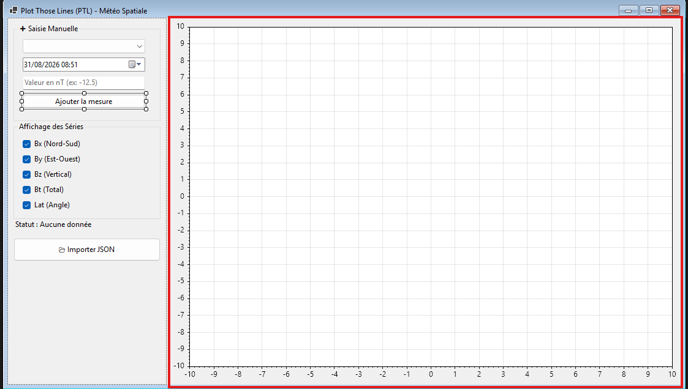
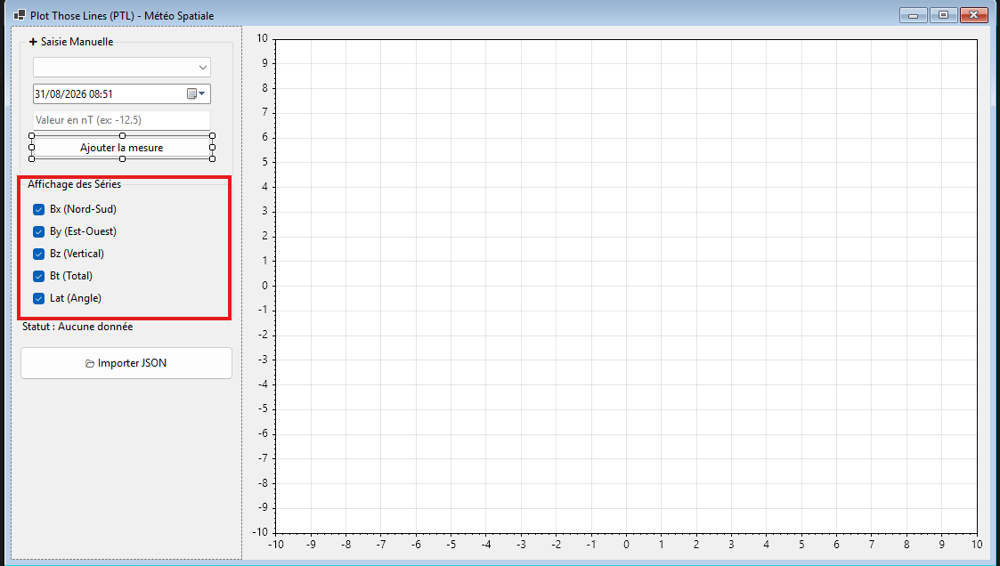
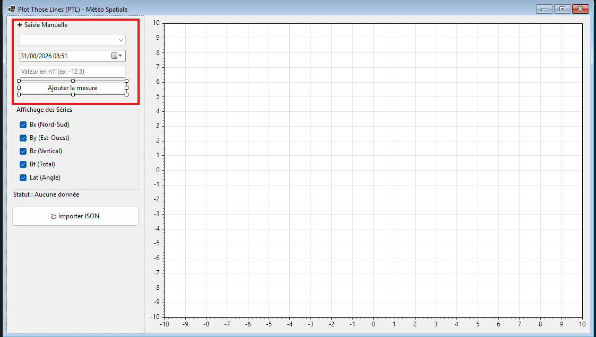

# Rapport
## table des matière
1. [introduction](#introduction)
    - 1.1 [objectifs produit](#objectifs-produit)
    - 1.2 [pédagogique](#pédagogique)
    - 1.3 [Description du domaine](#description-du-domaine)
2. [analyse fonctionnelle](#lanalyse-fonctionnelle)
3. [planification initiale](#la-planification-initiale)
    - 3.1[Macro-Planning](#macro-planning-du-projet)
4. [Rapport de tests](#rapport-de-tests)
5. [Utilisation de L'IA](#utilisation-de-lia-dans-ce-projet)
6. [Bilan de déroulement](#bilan-du-déroulement-de-projet)
7. [Bilan produit](#bilan-produit)
8. [Conclusion](#conclusion)
## introduction
### objectifs produit
Le projet Plot Those Lines (PTL) vise à concevoir une application dédiée à la visualisation et à l'analyse de la météo spatiale. L'application permet d'importer, de stocker localement et d'afficher simultanément jusqu'à 5 séries de données complexes sur un axe temporel commun. Grâce à une interface graphique flexible et un mode de fonctionnement 100 % hors-ligne.
### pédagogique
Ce projet permet de pratiquer et de valider les notions théoriques et techniques vues en cours
### Description du domaine
Le domaine d'application retenu pour ce projet est la météo spatiale, et plus particulièrement la surveillance des variations du champ magnétique interplanétaire (IMF) mesuré au point de Lagrange L1 entre le Soleil et la Terre (via le satellite DSCOVR de la NOAA).

La météo spatiale étudie l'impact de l'activité solaire sur l'environnement spatial terrestre. Lors d'éruptions solaires ou d'éjections de masse coronale, un vent solaire chargé en particules magnétisées frappe la la Terre. Ces événements peuvent perturber les satellites de télécommunication, dégrader les signaux GPS, créer des surtensions sur les réseaux électriques haute tension et générer des aurores polaires.

#### Cohérence d'affichage
Puisque les séries B_x_gse, B_y_gse, B_x_gsm, B_y_gsm et B_t partagent la même unité physique (le nanotesla, nT), elles peuvent être superposées directement sur un axe Y unique sans déformer l'affichage.
## L’analyse fonctionnelle
### #1 — Stockage local des séries temporelles

En tant qu' utilisateur,
je veux que l'ensemble des séries importées soit sauvegardé localement sur mon poste,
afin de pouvoir relancer le logiciel et travailler sur mes données en mode hors-ligne.

- [ ]  GIVEN des données importées avec succès, WHEN l'application est fermée puis rouverte, THEN les 5 séries temporelles sont automatiquement rechargées.
- [ ] GIVEN une utilisation sans connexion réseau, WHEN l'application démarre, THEN toutes les séries enregistrées localement restent accessibles.

---

### #3 — Affichage graphique simultané des 5 séries (ScottPlot)

En tant qu' utilisateur,
je veux afficher une représentation graphique de 5 séries du champ magnétique sur un axe temporel commun,
afin de comparer visuellement leurs variations en nanoteslas (nT) sur la même période.

- [ ] GIVEN 5 séries enregistrées, WHEN l'utilisateur ouvre la vue principale, THEN le graphique affiche les 5 courbes avec des couleurs distinctes.
- [ ] GIVEN le graphique affiché, WHEN l'utilisateur observe l'axe horizontal (X), THEN l'axe représente le temps (timestamps synchronisés).
- [ ] GIVEN le graphique affiché, WHEN l'utilisateur observe l'axe vertical (Y), THEN l'échelle est exprimée en nanoteslas (nT) pour toutes les séries.

---

### #4 — Sélection et filtrage dynamique des séries

En tant qu' utilisateur,
je veux pouvoir cocher ou décocher chaque série via des cases à cocher (Checkboxes),
afin de masquer les courbes inutiles et d'analyser en détail seulement 2 ou 3 séries spécifiques.

- [ ] GIVEN un graphique avec 5 séries actives, WHEN l'utilisateur décoche Bz_gsm, THEN la courbe correspondante disparaît immédiatement du graphique.
- [ ] GIVEN une série masquée, WHEN l'utilisateur coche à nouveau la case, THEN la courbe réapparaît exactement à sa place sans recharger l'ensemble des données.

---

### #5 — Ajout manuel d'une mesure à une série temporelle

[BONUS/si le temps le permet]

En tant qu' utilisateur,
je veux pouvoir ajouter manuellement une nouvelle valeur datée à une série existante,
afin de compléter mes données locales si une mesure manque.

- [ ] GIVEN une série sélectionnée, WHEN l'utilisateur saisit une date et une valeur valide puis valide, THEN le nouveau point est inséré dans le stockage local.
- [ ] GIVEN un nouveau point ajouté, WHEN le graphique se rafraîchit, THEN le point apparaît à la bonne position chronologique sur la courbe.
- [ ] GIVEN une saisie avec une valeur non numérique, WHEN l'utilisateur valide, THEN un message d'avertissement bloque la saisie.

---
vous pouvez vois les US avec les lien suivant :
- US-1 : https://github.com/Gianmarco-Ruberti/P_FUN-Gianmarco/issues/1#issue-5232498212
- US-2 : https://github.com/Gianmarco-Ruberti/P_FUN-Gianmarco/issues/2#issue-5232526328
- US-3 : https://github.com/Gianmarco-Ruberti/P_FUN-Gianmarco/issues/3#issue-5232601596
- US-4 : https://github.com/Gianmarco-Ruberti/P_FUN-Gianmarco/issues/4#issue-5232617330

## La planification initiale

La réalisation du projet s'étale sur **24 périodes** réparties du début du trimestre au **30 octobre 2026** (date de livraison finale).

### Macro-Planning du projet

| Phase | Périodes estimées | Activités principales | Livrable associé |
| :--- | :---: | :--- | :--- |
| **1. Analyse & Prise en main** | **4 périodes** | Choix du domaine, rédaction des US, validation du Kanban | **Release v1 (04.09.2026)** |
| **2. Modèle & Parsing JSON** | **4 périodes** | Création des classes C# (`DataPoint`, `Series`), lecture de `solar_mag.json` avec LINQ et stockage local. | Commits branche `main` |
| **3. Interface & ScottPlot** | **9 périodes** | Apprentissage de ScottPlot, création de l'interface WPF, affichage des 5 courbes et gestion des Checkboxes. | Commits branche `main` |
| **4. Fonctionnalités & Tests** | **4 périodes** | Ajout d'une mesure (US-05), création des 2 méthodes d'extension C#, écriture de 3 tests unitaires et corrections. | Rapport de tests |
| **5. Bilan & Documentation** | **3 périodes** | Rédaction de la section sur l'IA, mise au propre du journal de travail et préparation de la release finale. | **Release Finale (30.10.2026)** |

## Rapport de tests
L'obectif de ces test est de validé le fonctionnement de la méthode `LoadFromFile` lors du chargement des donnéees depuis un fichier JSON
les 3 test valide les points suivant :
1. les données valides issues du satéllite **SOLAR1** sont extraites et converties
2. les données d'autres source sont ignorées
3. le système donne les bonne exceptions en cas d'absence de données de **SOLAR1**

| ID Test | nom du test | Scénario de Test | Résultat attendu | Statut |
| :--------------- | :------------ | :---------------: | :---------------: | :------:|
| TU-01   | `LoadFromFile_ValidDataTests` | Chargement d'un fichier JSON contenant des données valide pour `SOLAR1` | Le fichier est lu sans erreur, 1 élément est retourné avec des valeurs `y_gse`, `bz_gse` et `bt` conformes. | **SUCCÈS** |
| TU-02   | `LoadFromFile_FilteringTests` | Chargement d'un fichier JSON contenant une donnée valide pour `SOLAR1` et une donnée de `ACE` | la donnée de `ACE` est ignorée et la donnée de `SOLAR1` est conservée | **SUCCÈS**
| TU-03   | `LoadFromFile_ExceptionTests` |  Chargement d'un fichier JSON contenant uniquement une donnée de `ACE` |  `InvalidDataException` est levée en indiquant l'absence de données valides. | **SUCCÈS**

### TU-01 : Validation du Cas Nominal (LoadFromFile_ValidDataTests.cs)
- Description : S'assure que les données extrait du JSON ont les propriétés requises (`ByGse`, `BzGse`, `Bt`, `TimeTag`) lorsque la source est SOLAR1.
- Couverture : Méthode LoadFromFile et méthode auxiliaire GetDoubleProperty.

### TU-02 : Validation du Filtrage (LoadFromFile_FilteringTests.cs)
- Description : Vérifie le respect des règles concernant la priorité et l'exclusion des satellites autre que **SOLAR1**.
- Couverture : Condition de filtrage source == "SOLAR1".

### TU-03 : Validation de la Gestion des Erreurs (LoadFromFile_ExceptionTests.cs)
- Description : S'assure que l'application ne traite pas un fichier invalide ou sans les données demander.
- Couverture : Bloc de validation final hasValidData et levée d'exception InvalidDataException.
## Utilisation de L'IA dans ce projet
Dans le cadre de ce projet et de la rédaction de ce rapport, une intelligence artificielle a été utilisée comme outil d'assistance méthodologique et technique. Son intervention s'est articulée autour de deux axes principaux :

- Analyse, compréhension et documentation du code : L'assistant a été sollicité pour faciliter l'assimilation de certaines sections complexes du programme, surmonter des points de blocage techniques et optimiser l'annotation du code source. Cette démarche collaborative a permis de garantir une documentation technique particulièrement rigoureuse, lisible et structurée.

- Assistance à la rédaction, reformulation et relecture : Sur le plan rédactionnel, l'outil a servi à la correction orthographique et grammaticale approfondie, tout en aidant à identifier un vocabulaire technique plus précis. Il a également permis de reformuler certaines explications conceptuelles afin de rendre le propos plus fluide, concis et directement accessible au lecteur.

après discution avec le prof je me suis rendus conte que mon utilisation de l'IA pour comprendre le code ètais trop sommaire se qui ne pas pas permis d'apprendre le code au long terme mais que au court terme
## Bilan du déroulement de projet

### Respect du planning
Bien que le planning initial n'ait pas été entièrement respecté, l'ensemble du projet est resté dans les temps. La réorganisation de certaines tâches s'explique par une réévaluation de leur durée et par l'acquisition de nouvelles connaissances techniques, qui m'ont incité à décaler le stockage local à la fin pour optimiser le travail.
### Méthodologie
J'ai appliqué la méthodologie agile Scrum à ce projet. la phase de débriefing en début de session s'est révélée très bénéfique : elle m'a permit de faire le point sur l'avancement avant de me lancer dans le code.
### Problèmes rencontré
Le principal obstacle rencontré résidait dans l'apparition de données "fantômes". Celles-ci provenaient d'un doublon lié à une double source de données dans le fichier JSON. Pour y remédier, j'ai mis en place un filtrage préalable afin de ne conserver qu'une seule source, amplement suffisante pour l'analyse.
## Bilan produit
### 7.1 Prévu / réalisé

| Fonctionnalité | Prévue | Réalisée | Commentaire |
|:---|:---:|:---:|:---|
| Stockage local des séries temporelles (US1) | Oui |  Oui | L'objectif est d'enregistrer automatiquement les 5 séries temporelles importées sur le poste de l'utilisateur pour qu'elles restent accessibles et rechargeables au redémarrage, même sans connexion réseau. |
| Importation des données du champ magnétique (US2) | Oui |  Oui | L'objectif est d'extraire de manière sécurisée et hors-ligne 5 séries temporelles spatiales de plus de 500 points chacune, tout en gérant proprement les cas de fichiers corrompus avec un message d'erreur. |
| Affichage graphique simultané des 5 séries (US3) | Oui |  Oui | L'objectif est d'afficher sur un graphique unique les courbes distinguées par couleur, partageant un axe temporel commun et une échelle unifiée en nanoteslas |
| Sélection et filtrage dynamique des séries (US4) | Oui |  Oui | L'objectif est de permettre à l'utilisateur de masquer ou réafficher instantanément chaque courbe sur le graphique sans recharger les données. |

#### Fonctions ajoutées, non prévues initialement

Ces fonctions ne sont dans aucune user story. Elles sont nées des problèmes
rencontrés pendant le développement :

| Ajout | Raison |
|:---|:---|
|filtre des source de données | a cause d'une double source de données il y avais de données phantome

## Conclusion
Au cours de ce projet, j'ai pu concevoir une application dédiée à la visualisation graphique en partant de demandes précises en termes de fonctionnalités : le stockage local, l'importation, le filtrage et l'affichage simultané de séries temporelles, pour lesquelles j'ai choisi le thème du champ magnétique interplanétaire. Ce projet m'a offert un bon cadre pour mettre en pratique les compétences de LINQ vues pendant le module.

Sur le plan personnel, ce projet m'a permis de comprendre l'importance d'une bonne structure de code et d'une bonne gestion des imprévus, comme la gestion des doublons de sources. Les discussions sur le code pendant ce projet m'ont aussi permis de souligner les défauts de ma manière d'apprentissage, qui était trop limitée dans le temps lors de l'utilisation de l'IA.

En somme, PTL a été un projet que j'ai apprécié et qui m'a permis de mieux gérer mes projets, de mieux comprendre la programmation et d'améliorer ma méthode d'apprentissage avec l'assistance de l'IA.